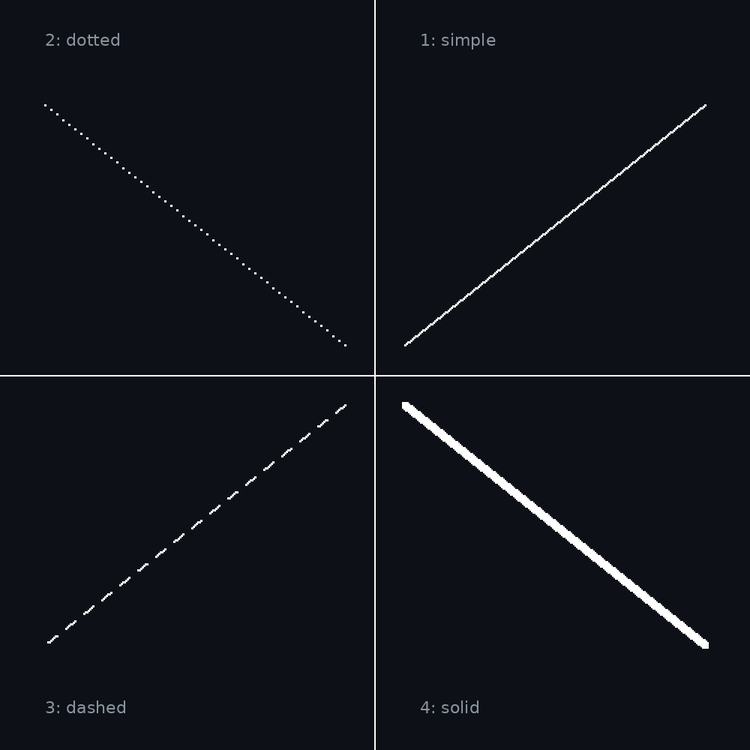
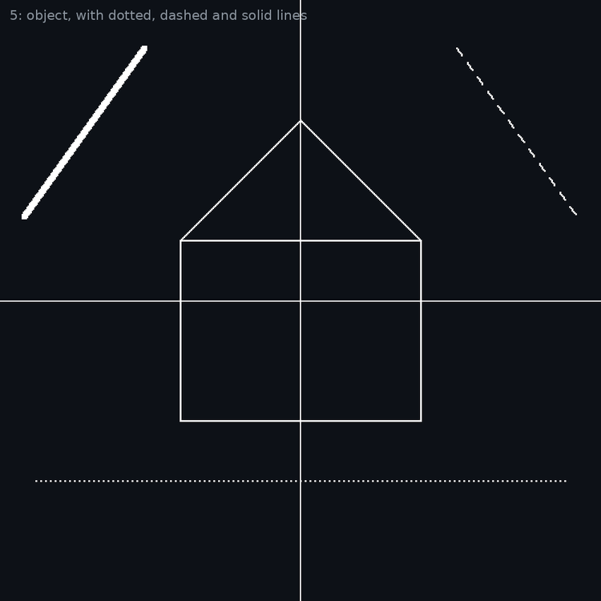
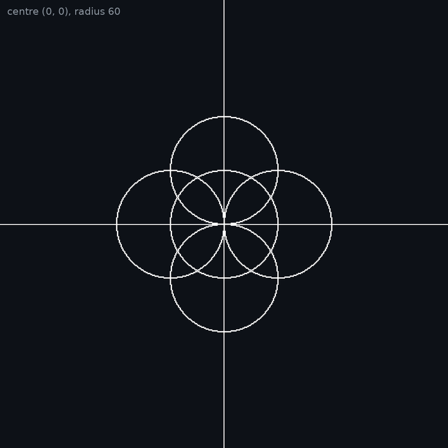
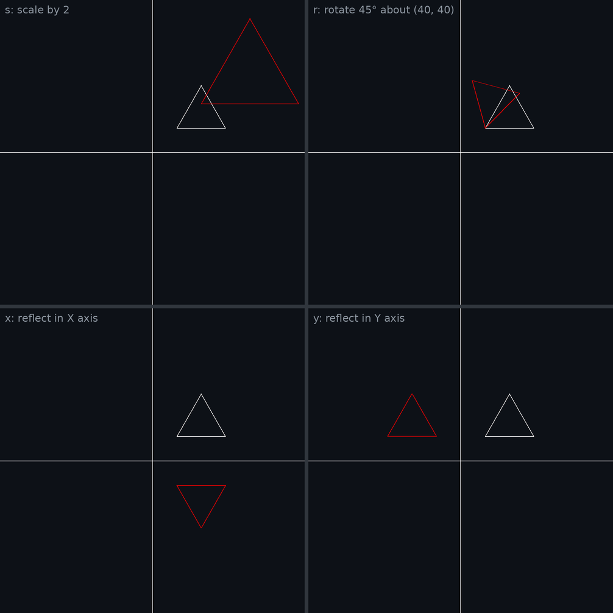

# Computer Graphics Practicals (C++ and OpenGL)

Four lab practicals for the Computer Graphics part of the OOPCG laboratory, written in C++ with OpenGL and GLUT. Practical numbers follow the lab assignment list, so they run 8, 9, 10 and 12.

## Practicals

| No. | Practical | Algorithm | File |
| --- | --- | --- | --- |
| 8 | Simple, dotted, dashed and solid lines | DDA line drawing | [08_dda_line.cpp](08_dda_line.cpp) |
| 9 | Line styles and an object | Bresenham line drawing | [09_bresenham_line.cpp](09_bresenham_line.cpp) |
| 10 | Object made of circles | Bresenham circle drawing | [10_bresenham_circle.cpp](10_bresenham_circle.cpp) |
| 12 | Scaling, rotation about an arbitrary point, reflection | 2D transformations | [12_2d_transformations.cpp](12_2d_transformations.cpp) |

## Requirements

A C++ compiler and freeglut.

| System | Install | Compile and run |
| --- | --- | --- |
| Ubuntu | `sudo apt install g++ freeglut3-dev` | `g++ 08_dda_line.cpp -o practical -lGL -lGLU -lglut && ./practical` |
| Windows (MSYS2 UCRT64) | `pacman -S mingw-w64-ucrt-x86_64-gcc mingw-w64-ucrt-x86_64-freeglut` | `g++ 08_dda_line.cpp -o practical -lfreeglut -lopengl32 -lglu32 && ./practical` |

## Common setup

Every program opens a 500 × 500 window and calls `gluOrtho2D(-250, 250, -250, 250)`. This puts the origin (0, 0) at the centre of the window, so the X and Y axes divide the screen into four quadrants.

Mouse clicks arrive in window coordinates measured from the top-left corner. They are converted with `x = x - 250` and `y = 250 - y`.

## About the output images

The images in [output/](output) are previews produced by running each program's drawing functions and plotting the points they generate. They are not screenshots of the OpenGL window. The grey labels were added to the previews and are not drawn by the programs.

---

## 8. DDA line drawing

**Problem statement:** Implement the DDA line drawing algorithm to draw a simple line, a dotted line, a dashed line and a solid line using the mouse interface. Divide the screen into four quadrants with the centre at (0, 0). The line should work for all slopes, positive as well as negative.

**Algorithm**

1. Read the end points (x1, y1) and (x2, y2).
2. Calculate dx = x2 - x1 and dy = y2 - y1.
3. steps = the larger of |dx| and |dy|.
4. x increment = dx / steps, y increment = dy / steps.
5. Starting from (x1, y1), plot the rounded point and add the increments. Repeat steps + 1 times.

Because the increments carry the sign of dx and dy, the same loop handles every slope and direction.

**Line styles**

| Key | Style | Rule |
| --- | --- | --- |
| 1 | Simple | Every point is plotted |
| 2 | Dotted | Every 4th point is plotted |
| 3 | Dashed | 7 points plotted, 5 skipped, repeated |
| 4 | Solid | Every point plotted with point size 4 |

**Controls:** press 1, 2, 3 or 4 to choose the style, then click two points to draw a line between them.

**Output preview**

## 9. Bresenham line drawing

**Problem statement:** Implement the Bresenham line drawing algorithm to draw a simple line, a dotted line, a dashed line, a solid line and an object using the mouse interface. Divide the screen into four quadrants with the centre at (0, 0). The line should work for all slopes, positive as well as negative.

**Algorithm**

1. Calculate dx = |x2 - x1| and dy = |y2 - y1|. Set sx and sy to +1 or -1 for the direction of travel.
2. If dx >= dy (gentle slope), start with decision parameter p = 2dy - dx. At each step move x by sx. If p < 0, add 2dy to p. Otherwise move y by sy and add 2(dy - dx) to p.
3. If dx < dy (steep slope), the roles of x and y are swapped: p = 2dx - dy and y moves every step.

Only integer addition and comparison are used, which makes it faster than DDA.

**Controls:** keys 1 to 4 choose the line style as in practical 8. Click two points to draw a line. Press 5 to draw the object, a house built from six Bresenham lines.

**Output preview**

## 10. Bresenham circle drawing

**Problem statement:** Implement the Bresenham circle drawing algorithm to draw any object. The object should be displayed in all the quadrants with respect to centre and radius.

**Algorithm**

1. Start at x = 0, y = r with decision parameter d = 3 - 2r.
2. Plot the eight symmetric points of (x, y) around the centre.
3. If d < 0, d = d + 4x + 6. Otherwise d = d + 4(x - y) + 10 and y = y - 1.
4. Increase x by 1. Repeat while x <= y.

Only one-eighth of the circle is calculated. The other seven parts come from symmetry.

**Controls:** the program asks for the centre and radius in the terminal. The object is five circles: one at the centre and four shifted by one radius left, right, up and down. With centre (0, 0) it spreads over all four quadrants.

**Output preview** (input `0 0 60`)

## 12. 2D transformations

**Problem statement:** Implement the following 2D transformations on an object with respect to the axes: scaling, rotation about an arbitrary point, and reflection.

**Formulas**

| Transformation | New point (x', y') |
| --- | --- |
| Scaling by sx, sy | x' = x · sx, y' = y · sy |
| Rotation by angle θ about (xr, yr) | x' = xr + (x - xr) cos θ - (y - yr) sin θ, y' = yr + (x - xr) sin θ + (y - yr) cos θ |
| Reflection in the X axis | x' = x, y' = -y |
| Reflection in the Y axis | x' = -x, y' = y |

Rotation about an arbitrary point combines three steps: translate the point to the origin, rotate, translate back.

**Controls:** the white triangle is the original object and the red triangle is the result.

| Key | Transformation |
| --- | --- |
| s | Scale by 2 |
| r | Rotate 45° about the point (40, 40) |
| x | Reflect in the X axis |
| y | Reflect in the Y axis |

**Output preview**

---

## Author

Pranav Joshi ([@pranav-0712](https://github.com/pranav-0712))
